# Evidence gallery

Fourteen unique images from sixteen supplied attachments. Duplicate pairs were verified by SHA-256. Images were copied without editing.

## 1. 01-domain-membership.png

Original: QZQlUi8.png

Domain membership query shows PC-01 in corp.example.test; earlier runas attempts show errors 1326 and 1907.

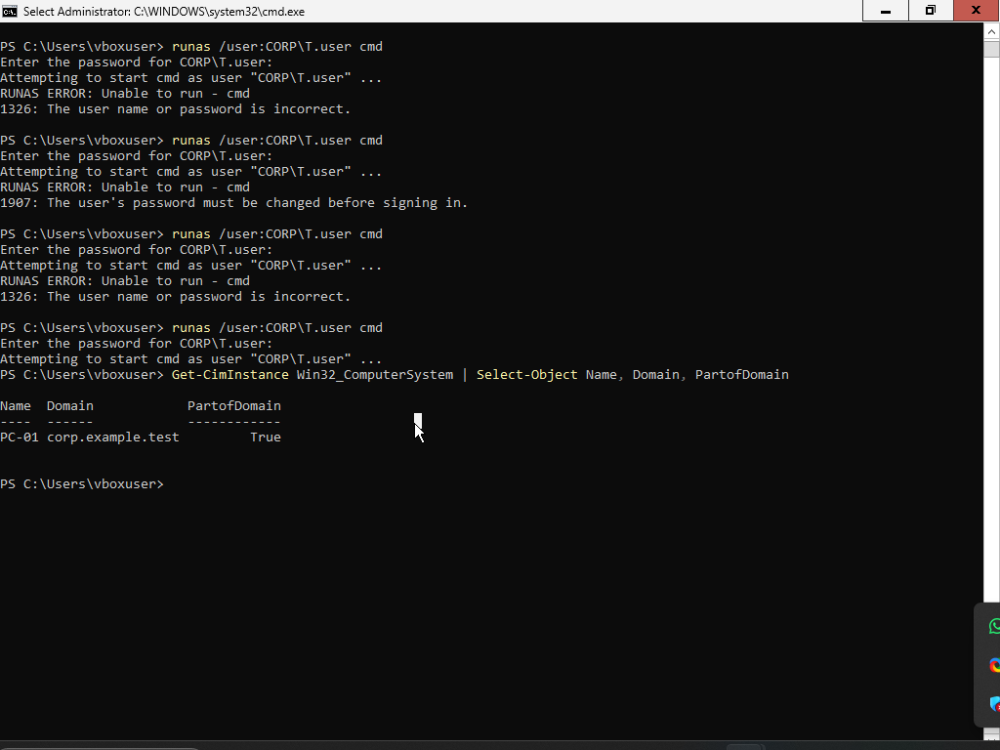

## 2. 02-department-ous.png

Original: eSQd1iw.png

ADUC shows Departments with Finance, HR and IT OUs, and HR Test as a user display name.

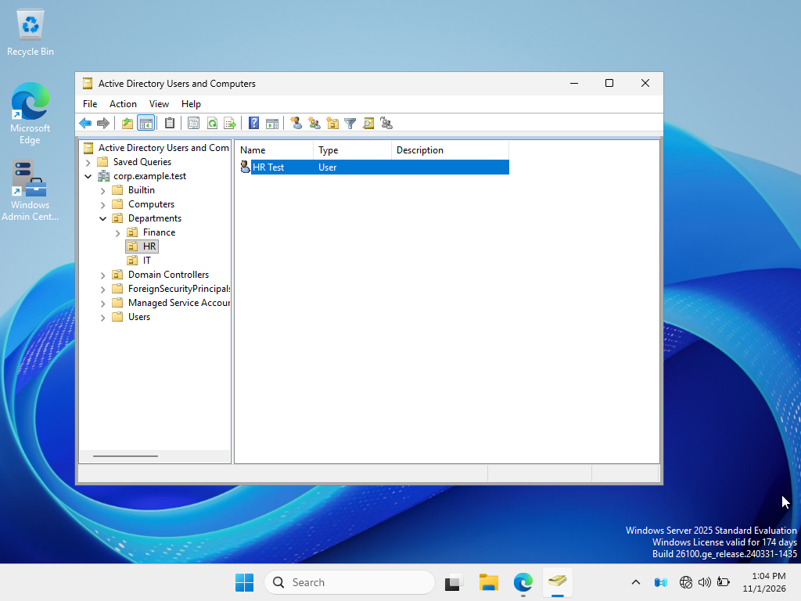

## 3. 03-it-user-token.png

Original: eamoyZR.png

T.user identity and token show CORP\GG_IT_Users; includes the corrected whoami /groups command.

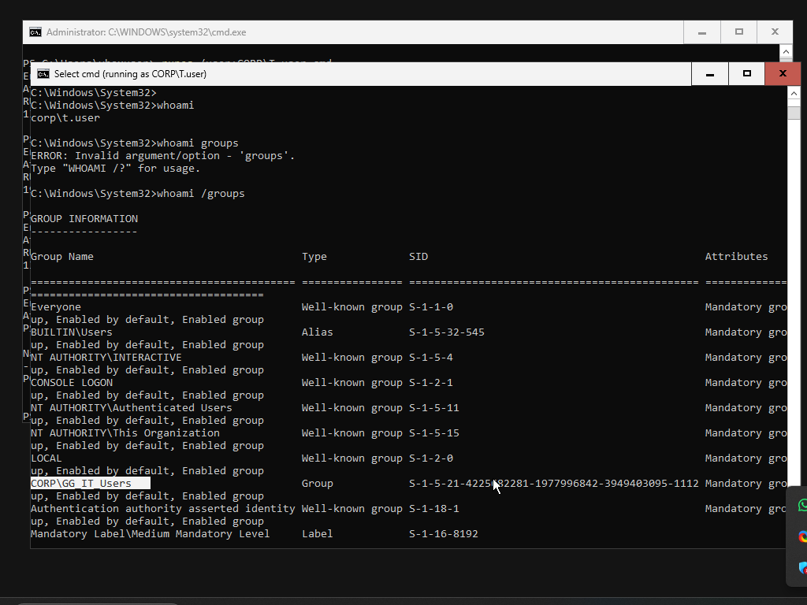

## 4. 04-it-share-permissions.png

Original: VLQBmSE.png

IT group share permissions: Change and Read checked; Full Control unchecked.

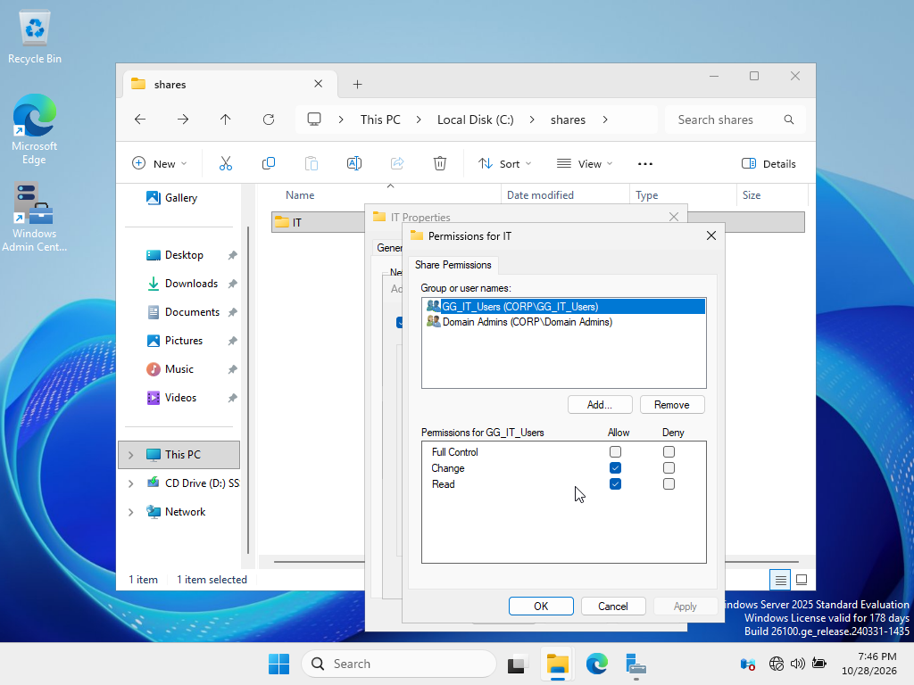

## 5. 05-admin-share-permissions.png

Original: KF8yAkD.png

Domain Admins share permissions: Full Control, Change and Read checked.

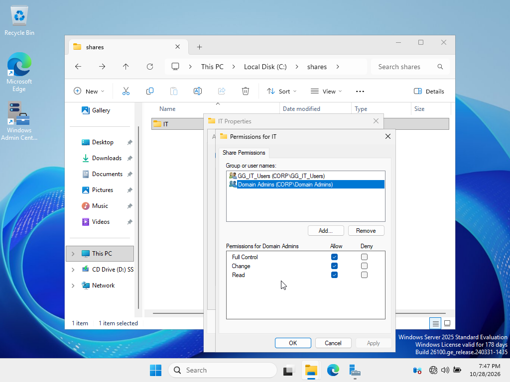

## 6. 06-it-ntfs-permissions.png

Original: 6ZbsQzU.png

IT group NTFS permissions include Modify; full ACL and scope are not visible.

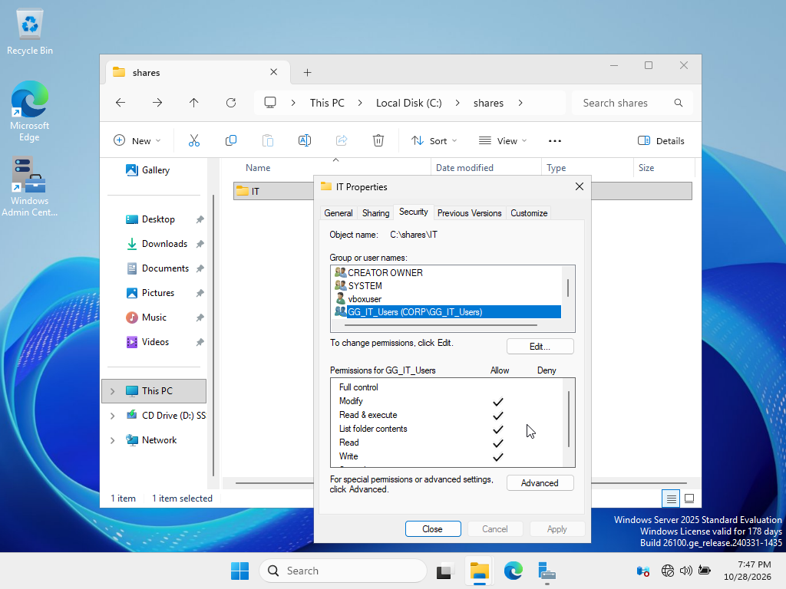

## 7. 07-inherited-ntfs-entries.png

Original: 7hVCKVf.png

Administrators entry shows grey permission checks; Users and vboxuser entries also appear. Inspect inheritance.

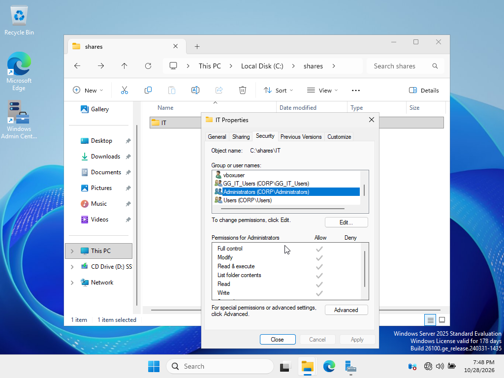

## 8. 08-empty-share.png

Original: 5wVnkbB.png

IT folder before the test: empty and marked shared.

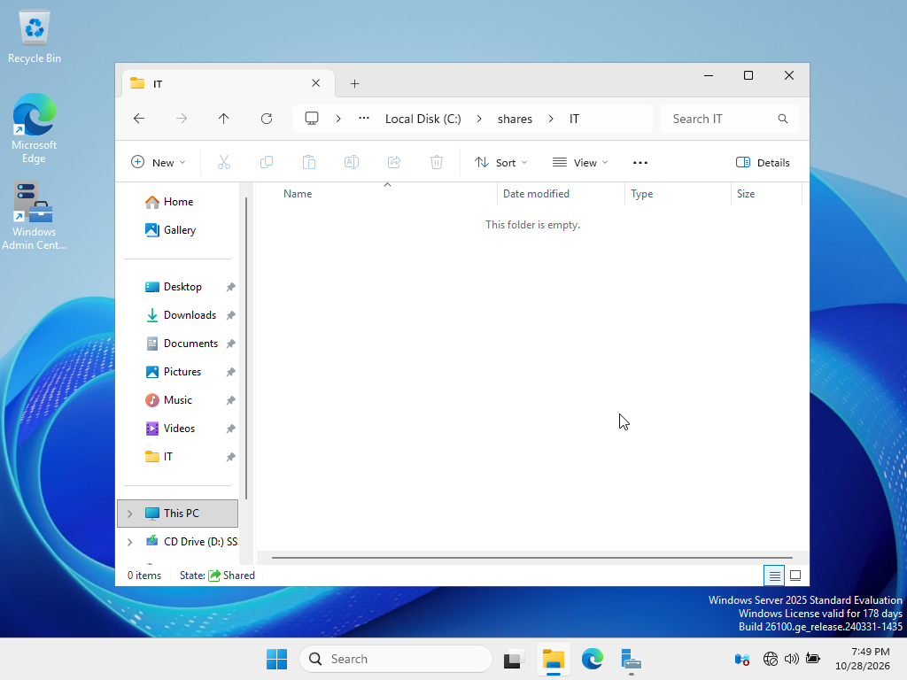

## 9. 09-it-create-read.png

Original: 5MErBYc.png

IT session lists the share, writes test.txt and reads Access test.

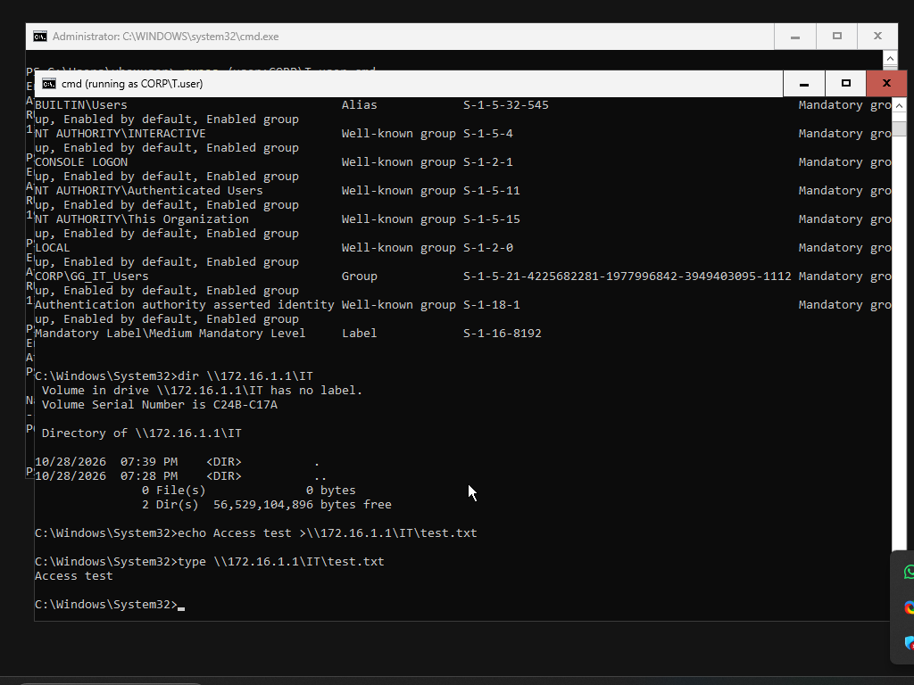

## 10. 10-file-on-server.png

Original: JM9bBbT.png

Server-side view shows test.txt and its Access test content.

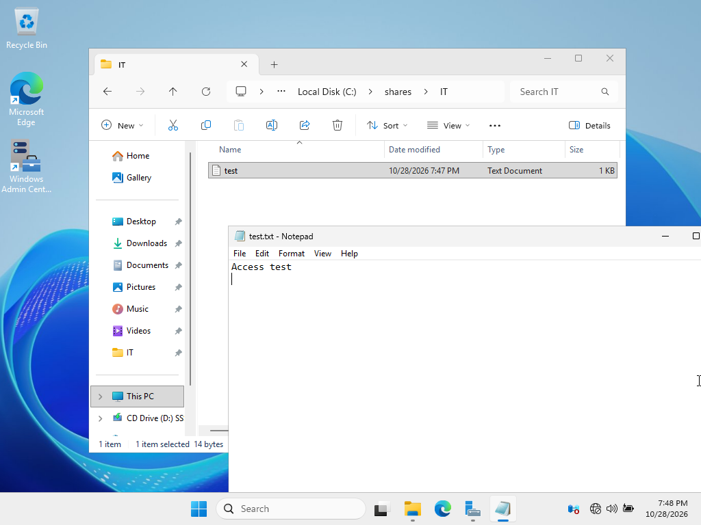

## 11. 11-it-delete.png

Original: JT4V2Pa.png

IT session deletes the file and lists an empty directory; a repeated delete reports file not found.

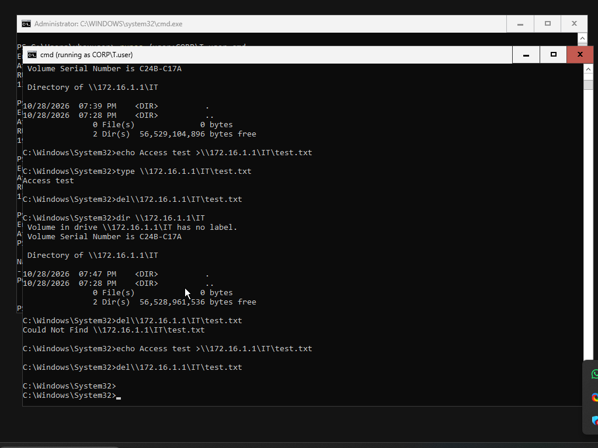

## 12. 12-hr-denied.png

Original: l2La1Fj.png

CORP\HR identity and Access is denied for the IT UNC listing appear together.

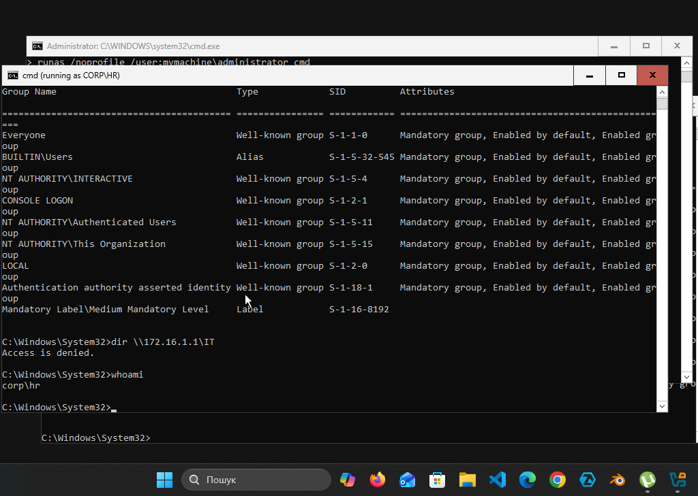

## 13. 13-logon-gpo.png

Original: HeIRBJ6.png

GPMC shows title AD Lab and text Authorized lab users only for the logon notice.

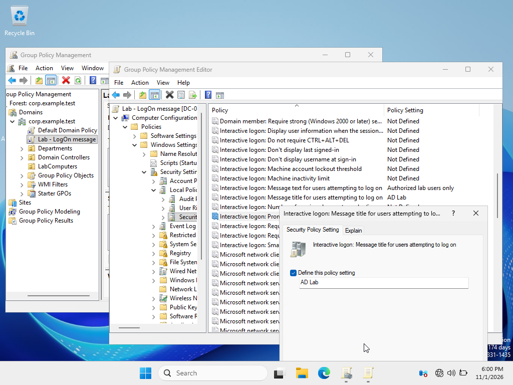

## 14. 14-logon-message.png

Original: cL0ZPEj.png

LogonUI shows matching title and text; host identity and applied GPO are not visible.

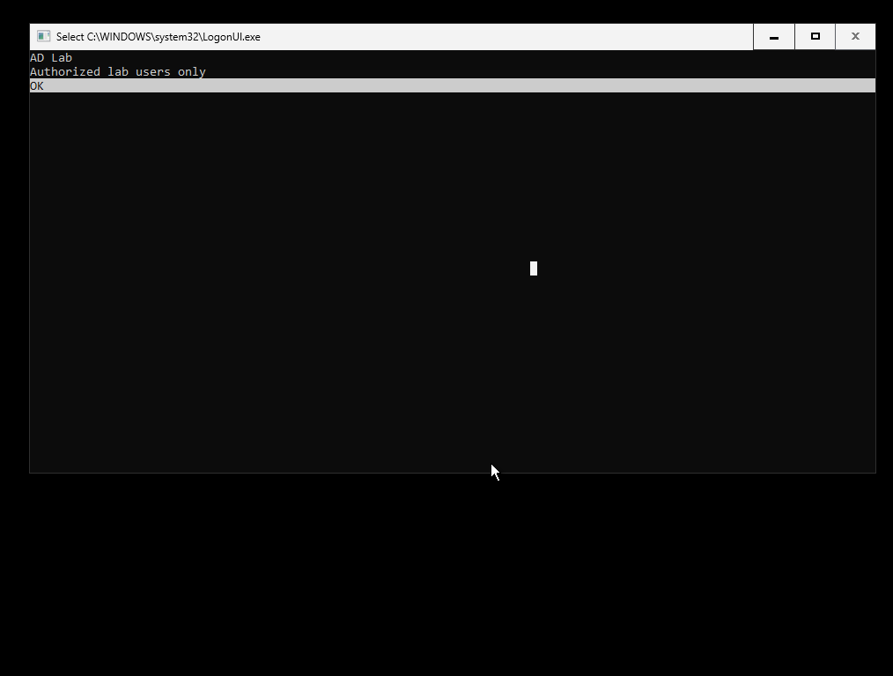

